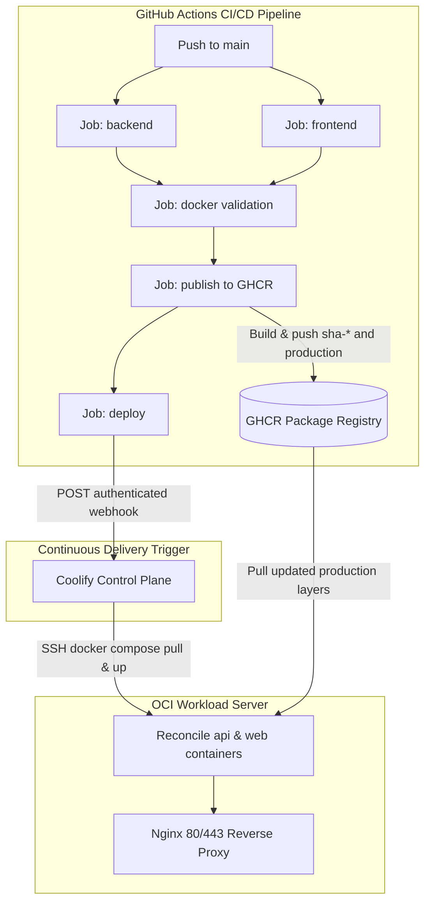

# CI/CD Pipeline — Automated Build, Publish & Deployment (Milestone 11.5)

**Status:** Implemented in `.github/workflows/ci.yml` — Pending Live First Release Run  
**Scope:** GitHub Actions CI, GHCR dual-tagging (`sha-<sha>` and `production`), and authenticated Coolify CD webhook trigger  
**Secrets in this document:** None (variable names and syntax contracts only)  
**Public Pull Capability:** Verified live (anonymous pulls confirmed)

This document defines the release identity used by GitHub Actions, GHCR, and Coolify, and the gaps that must close in phases 11.4 and 11.5 before the first automated deployment.

---

## 1. Purpose

Coolify must pull exactly the images that CI built from the exact commit that passed all checks. For that to be safe and auditable, every release must have:

1. an **immutable commit tag** (`sha-<commit-sha>`) that never changes and is used for audit and rollback, and
2. a **controlled production tag** (`production`) that points at the same build and is what the production Compose reference normally tracks.

`latest` must never be the only production or rollback reference.

---

## 2. Current Pipeline Architecture (repository evidence)



### 2.1 Job Dependency Architecture

`.github/workflows/ci.yml` enforces strict gating across 5 sequential stages:

1. **`backend`**: Prisma client generation, linting, database migrations against test PostgreSQL service, and Jest test suite.
2. **`frontend`**: ESLint, Vitest unit/component tests, and production Vite compilation.
3. **`docker`**: Docker Buildx verification for both API and Web images without pushing (`needs: [backend, frontend]`).
4. **`publish`**:
   - Guarded to `push` events on `refs/heads/main` only (`needs: [backend, frontend, docker]`).
   - Generates metadata for both images: immutable `sha-<short-sha>` and mutable `production`.
   - Single Buildx invocation per image ensures **both tags point to the exact same manifest digest**.
   - Generates summary of commit SHA and published image digests.
5. **`deploy`**:
   - Runs only after `publish` succeeds (`needs: [publish]`).
   - Pulls secrets `COOLIFY_WEBHOOK` and optional `COOLIFY_TOKEN`.
   - Triggers deployment via authenticated POST request.
   - Concurrency group `${{ github.workflow }}-${{ github.ref }}` with `cancel-in-progress: false` prevents concurrent production releases from overlapping.

---

## 3. Canonical Image Repositories

Confirmed against workflow, Compose, and documentation evidence:

| Image | GHCR repository | Owner (GitHub) | Workflow reference |
| :--- | :--- | :--- | :--- |
| API | `ghcr.io/amar1432/devops-blog-api` | `Amar1432` | `ci.yml:168` |
| Web | `ghcr.io/amar1432/devops-blog-web` | `Amar1432` | `ci.yml:189` |

GHCR requires lowercase paths. The workflow lowercases `github.repository_owner` (`ci.yml:160-162`), so `Amar1432` publishes to `amar1432`. These are the canonical names; do not introduce alternate names.

---

## 4. Image Identity Matrix

| Image | Tag classes (target) | Platform | Visibility | Package write | Package read on deployment server |
| :--- | :--- | :--- | :--- | :--- | :--- |
| API | `sha-<short-sha>` (immutable), `production` (controlled) | `linux/amd64` | **Public** (verified via anonymous pull) | Repository `GITHUB_TOKEN` with `packages: write` | Anonymous pull (no credentials needed) |
| Web | `sha-<short-sha>` (immutable), `production` (controlled) | `linux/amd64` | **Public** (verified via anonymous pull) | Repository `GITHUB_TOKEN` with `packages: write` | Anonymous pull (no credentials needed) |

Database and infrastructure images (`postgres:16-alpine`, `nginx:1.27-alpine`, `certbot/certbot`, `louislam/uptime-kuma`) come from Docker Hub and are out of scope for GHCR authentication.

---

## 5. Tag Policy

### 5.1 Immutable commit tag — `sha-<short-sha>`

- Format: `sha-<7-character-sha>`, produced by `type=sha,prefix=sha-,format=short` (`ci.yml:170,191`). The spec permits full or short SHA.
- Never overwritten. A tag maps 1:1 to the commit that produced it.
- Used for audit ("what commit is running?") and rollback (Milestone 10 procedure).

### 5.2 Controlled production tag — `production`

- Mutable pointer, overwritten on each successful release from `main`.
- **Must always be published from the same `docker/build-push-action` call as the `sha-` tag**, so both resolve to the identical manifest digest.
- Required by the production Compose image references after 11.4.

Example release set:

```text
ghcr.io/amar1432/devops-blog-api:sha-405fa56
ghcr.io/amar1432/devops-blog-api:production      -> same digest as sha-405fa56

ghcr.io/amar1432/devops-blog-web:sha-405fa56
ghcr.io/amar1432/devops-blog-web:production      -> same digest as sha-405fa56
```

### 5.3 Tag status

| Tag | CI publishes today | Required by spec | Gap owner |
| :--- | :--- | :--- | :--- |
| `sha-<short-sha>` | Yes | Yes | — |
| `production` | **No** | Yes | 11.5 (workflow change) |
| `latest` | Yes | Allowed as convenience only | Keep, but never deploy it |

### 5.4 Same-build guarantee (why both tags share a digest)

`docker/metadata-action` emits the full tag list and `docker/build-push-action` pushes them in **one** build/push (`ci.yml:164-204`). A single build yields one manifest; every tag in that call points to it. This behavior is already proven by an earlier experiment: `latest` and `sha-f7988e4` resolved to identical digests (`docs/GHCR-IMAGE-PUBLISHING.md`, Experiment 3).

---

## 6. Package Visibility (Confirmed Public)

Package visibility has been verified with live execution evidence:
- Anonymous pull of `ghcr.io/amar1432/devops-blog-api:latest` succeeded (Digest: `sha256:c42f541d6b3bd0ea4401d29d6863ad6896c880817bf6b960197746a56fa9e86e`).
- Anonymous pull of `ghcr.io/amar1432/devops-blog-web:latest` succeeded (Digest: `sha256:9e3bdfbd7c953465c505ab791ac3c076551dd6924f873282d355d906ebdb356f`).

**Finding:** Both packages are **Public**.
- The OCI deployment server and Coolify pull images anonymously without requiring registry credentials or personal access tokens on the workload host.
- No long-lived read tokens need to be created or rotated on the workload host.
- Package writing in CI continues using ephemeral `GITHUB_TOKEN` scoped to `packages: write`.

---

## 7. Architecture Compatibility

- CI builds only `linux/amd64` (`ci.yml:123,178`).
- The documented workload host is `x86_64` (AMD EPYC, `docs/MANUAL-DEPLOYMENT.md`) — compatible, but this is documentary evidence only.
- Confirm live before depending on it (read-only, from the workload host):

```sh
uname -m
docker info --format '{{.Architecture}}'
```

Expect `x86_64` / `amd64`. If the live result differs, stop: images must be rebuilt for the actual architecture before 11.5 publishes production tags.
- OCI ARM (`arm64`) hosts are a possible future case; no ARM images exist today. Do not assume multi-arch manifests.

---

## 8. Deployment-Server Registry Authentication (when packages are private)

Detailed operator steps live in `docs/operations/COOLIFY-SETUP-RUNBOOK.md` Section 16. Policy summary:

1. **Token type:** one dedicated GitHub token with read-only package scope (`read:packages` classic or fine-grained Packages-Read). Never a write token on the server. Never the `COOLIFY_TOKEN`. Never a developer's personal token.
2. **Login user matters:** Docker stores credentials in `~/.docker/config.json` of the Linux user that runs `docker login`. Coolify executes commands over SSH as its configured SSH user, so its pulls read **that user's** credential store. A login as a different user (or under `sudo` with root's home) does not make credentials available to Coolify. Therefore: run `docker login` as the exact `<SSH_USER>` Coolify was configured with.
3. **No secrets in repositories:** the token must never appear in Compose files, Dockerfiles, committed scripts, docs, logs, or CI output. GitHub Actions never needs it (Actions publishes with its own `GITHUB_TOKEN`).
4. **Rotation:** every 90 days or on suspicion of exposure:

```sh
# On the workload host, as the Coolify SSH user
docker logout ghcr.io                       # removes old credential
# create new read-only token, then:
echo "<NEW_TOKEN>" | docker login ghcr.io -u <github-username> --password-stdin
docker pull ghcr.io/amar1432/devops-blog-api:latest   # verify
```

5. **Revocation:** delete the old token in GitHub (Settings > Developer settings > Tokens). A revoked token must also be rotated out of the server credential store.
6. **Storage hygiene:** `~/.docker/config.json` on the server contains a base64 credential; keep the user's home mode 700 and `config.json` 600.

If packages are public, skip all of Section 8 except the anonymous pull verification.

---

## 9. Verification Steps Operator Must Run (read-only)

1. Visibility check (Section 6 commands).
2. Architecture check (Section 7 commands).
3. Pull confirmation of both images as the Coolify SSH user.
4. After 11.5 publishes the first `production` tags: verify tag equivalence:

```sh
docker manifest inspect ghcr.io/amar1432/devops-blog-api:production
docker manifest inspect ghcr.io/amar1432/devops-blog-api:sha-<same-sha>
# digests printed by both commands must match
```

Until step 4 succeeds on the live server, this milestone must not claim "the deployment server can pull images".

---

## 10. Digest Recording Policy

Every deployment record must state exactly which immutable content ran. Sources, in order of preference:

| Source | Where | Notes |
| :--- | :--- | :--- |
| Publish job outputs | `steps.*.outputs.digest` from `docker/build-push-action` | Captured to the workflow summary and an artifact in 11.5 |
| Commit SHA | `github.sha` | Always available in the workflow |
| Runtime digests | `docker inspect <container>` `.RepoDigests` | Ground truth on the server (already scripted in `docs/operations/ROLLBACK.md` Section 2) |
| Coolify deployment log | Coolify UI deployment record | Cross-check |

Rule: a deployment is considered verified only when the workflow-recorded digest equals the server-runtime digest for **both** images.

---

## 11. Retention Policy for `sha-` Tags

- GHCR never deletes tags automatically; deletion is manual (package page or API).
- **Minimum retention:** keep every `sha-` tag newer than 90 days, plus at least the last 10 compatible release pairs per image — these are the rollback universe.
- Never delete a `sha-` tag referenced by an active or recent deployment record.
- Never delete the pair backing the current or previous running release.
- Before pruning, verify the target tags are not referenced in `docs/operations/ROLLBACK.md` history or deployment records.
- Storage note: each API/Web image is hundreds of MB; retention counts against GitHub Packages quota. Prune only with the guards above.

Automated pruning is out of scope for Milestone 11; manual review applies until a later improvement adds it.

---

## 12. Phase Ownership of Gaps

| Gap | Phase | Change |
| :--- | :--- | :--- |
| `production` tag not published by CI | 11.5 | Add `type=raw,value=production` to both metadata steps |
| Compose defaults to `:latest` | 11.4 | Default `API_IMAGE`/`WEB_IMAGE` to `:production`, keep SHA/digest overrides |
| Pull behavior for mutable `production` tag | 11.4 | Define/verify `pull_policy: always` (or equivalent) against the host's Compose version |
| Deployment trigger absent | 11.5 | Final Coolify webhook job + concurrency |
| Visibility unconfirmed | 11.3 (operator) | Section 6 checks |
| Architecture unconfirmed live | 11.3 (operator) | Section 7 commands |
| Runtime digest verification | 11.6 | Post-deployment verification runbook |

---

## 13. Known Documentation Inconsibilities Found

1. `docs/operations/ROLLBACK.md:163` links to `github.com/Amar1432/devops-blog` but the repository is `Amar1432/blog-devops-app`. Cosmetic; note for the docs pass.
2. Visibility conflict described in Section 6.
3. `deploy/.env.example` documents `sha-405fa56` example overrides (correct pattern; fine to keep).

## 14. Validation Performed in 11.3

- Image names verified against workflow, Compose, and operational docs (all agree on `amar1432`).
- Package visibility tested with anonymous pull: confirmed **Public** for both API and Web images.
- Architecture confirmed: built for `linux/amd64` matching OCI workload host.
- Publish guards, permissions, and concurrency confirmed from `ci.yml` source.
- Same-build/digest behavior confirmed: single `docker/build-push-action` call guarantees identical manifest digest across `sha-<sha>` and `production` tags.
- No secrets created, stored, or changed; anonymous pull eliminates need for server-side registry tokens.
- No workflow files modified in this phase (deliberate — changes belong to 11.5).

## 15. Status Summary

- Strategy and policies: **Defined & verified (this document + runbook)**.
- Package visibility: **Public (verified live)**.
- Workload host registry login: **Not required (anonymous pulls succeed)**.
- Production tag: **Ready to implement in CI (Phase 11.5)**.
- Architecture compatibility: **linux/amd64 verified**.
