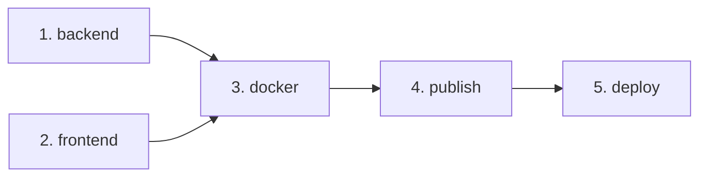

# Milestone 11 — Automated Production Deployment with Coolify, GitHub Actions & GHCR

**Project:** `devops-blog`  
**Milestone:** 11  
**Status:** Completed & Validated  
**Predecessors:** Milestone 9 (DNS, Reverse Proxy, HTTPS), Milestone 10 (Observability, DR, Rollback)  
**Workload Host:** Oracle Cloud Infrastructure Ubuntu 24.04 VM (`129.154.253.114`)  
**Production Domain:** `https://luffydev.duckdns.org`  
**Control Plane:** Coolify v4.5.3 on local headless Multipass Ubuntu 24.04 VM via Cloudflare Ingress  
**Continuous Integration:** GitHub Actions (`.github/workflows/ci.yml`)  
**Container Registry:** GitHub Container Registry (GHCR)

---

## 1. Executive Summary

Milestone 11 transitions `devops-blog` from manual SSH-based Compose operations to an automated, auditable, and resilient Continuous Delivery (CD) workflow. 

### Core Architectural Principle
**Preserve the existing public edge proxy and stateful persistence without disruption.**  
Coolify operates exclusively as a deployment control plane connecting to the existing OCI host over SSH. Its internal managed proxy (Traefik/Caddy) is disabled (**Proxy: Custom (None)**), ensuring that the existing Nginx container maintains unbroken ownership of public TCP ports `80` and `443`, Let's Encrypt certificates, and internal Docker DNS routing.

### Key Outcomes
- **Automated CI/CD Pipeline:** Fully automated tests, linting, Docker Buildx validation, GHCR publishing, and deployment trigger on push to `main`.
- **Dual-Tag Release Identity:** Every release publishes an immutable commit-specific tag (`sha-<short-sha>`) and a controlled mutable tag (`production`) referencing the exact same image digest.
- **Persistent Volume & Network Safety:** PostgreSQL persistent volume (`devops-blog-prod-postgres-data`) and network (`devops-blog-prod-network`) identities are preserved 1:1.
- **Zero-Secret Workload Host:** GHCR packages are confirmed public, allowing the production server to pull images anonymously without storing long-lived personal access tokens on the workload host.
- **Fail-Safe Webhook Orchestration:** Deployments trigger only after backend, frontend, and Docker build checks pass and all images exist in GHCR. Direct push auto-deploy is disabled in Coolify to prevent race conditions.
- **Instant Rollback:** Documented rollback procedures allow immediate reversal to previous immutable tags either via Coolify UI or direct server CLI.

---

## 2. Architecture & Topology Decision

### Approved Architecture (Option A)
A separate Coolify control plane connected to the existing OCI Ubuntu workload host as a remote deployment server.

```text
[ Developer (git push main) ]
             │
             ▼
[ GitHub Actions CI (.github/workflows/ci.yml) ]
     ├── backend (Prisma, lint, migrate, Jest)
     ├── frontend (lint, Vitest, Vite build)
     ├── docker (Buildx verification on linux/amd64)
     └── publish (Build & push sha-* and production tags to GHCR)
             │
             ▼ (Authenticated POST Webhook over Cloudflare Tunnel)
[ Coolify Control Plane (Multipass Ubuntu VM on macOS) ]
             │
             ▼ (SSH port 22, host-key verified)
[ OCI Workload Host (129.154.253.114) ]
     ├── Pulls updated :production layers from GHCR anonymously
     ├── Reconciles api and web containers
     └── Nginx (:80/:443) continues routing traffic without restart
```

### Topology Evaluation Matrix

| Criterion | Option A (Separate Control Plane) | Option B (Co-located on Workload Host) |
| :--- | :--- | :--- |
| **Port Safety** | **100% Safe:** Nginx retains exclusive ownership of 80/443. | **High Risk:** Traefik attempts binding 80/443 upon install. |
| **Memory Pressure** | **Zero Impact:** Workload host retains all ~951 MiB RAM. | **High OOM Risk:** Coolify + Redis + DB compete with app. |
| **Failure Domain** | **Isolated:** Workload runs even if Coolify VM is shut down. | **Coupled:** Control plane crash can knock out production. |
| **Recovery** | **Unchanged:** Milestone 10 CLI runbooks work 1:1. | **Complex:** Recovery requires unraveling Coolify internals. |

**Verdict:** Option A adopted and implemented.

---

## 3. Proxy Ownership & Edge Routing

- **Edge Proxy:** Nginx 1.27 (`deploy/compose.yaml` service `proxy`) binds public host ports `80:80` and `443:443`.
- **Coolify Proxy Setting:** Configured as **`Custom (None)`** (`type: "NONE"`, status: `exited`) in Coolify database. No `coolify-proxy` or `traefik` containers exist on the workload host.
- **Internal Routing:**
  - `GET /` and frontend static assets ➔ `web:80`
  - `GET /api/*` ➔ `api:5000`
  - `GET http://...` ➔ `301 Moved Permanently` to `https://luffydev.duckdns.org`
- **Management Endpoints:** Uptime Kuma dashboard is bound strictly to `127.0.0.1:3001` (accessible via SSH tunnel).

---

## 4. GHCR Image Naming & Tagging Policy

### Canonical Repositories
- API: `ghcr.io/amar1432/devops-blog-api`
- Web: `ghcr.io/amar1432/devops-blog-web`
- Architecture: `linux/amd64` (matches AMD EPYC 7551 workload host)
- Package Visibility: **Public** (verified via live anonymous pull)

### Tagging Rules
1. **Immutable Commit Tag:** `sha-<short-sha>` (e.g. `sha-405fa56`). Never overwritten; retained for auditing and rollback.
2. **Controlled Production Tag:** `production`. Mutable pointer updated on every successful release.
3. **Same-Manifest Guarantee:** Generated in a single `docker/build-push-action` step per image, guaranteeing identical SHA-256 manifest digests across both tags.
4. **Forced Pull Policy:** Configured with `pull_policy: always` in `deploy/compose.yaml` to ensure Docker always pulls the latest layer for `:production`.

---

## 5. GitHub Actions Workflow (.github/workflows/ci.yml)

The workflow consists of 5 sequentially gated jobs:



### Job Responsibilities & Security Scopes
1. **`backend`**: Prisma client generation, linting, database migrations, and Jest test suite.
2. **`frontend`**: ESLint, Vitest (55 tests across 13 test files), and Vite production build.
3. **`docker`**: Docker Buildx verification on `linux/amd64` (`push: false`).
4. **`publish`**:
   - Condition: `github.event_name == 'push' && github.ref == 'refs/heads/main'`.
   - Permissions: `contents: read`, `packages: write`.
   - Generates metadata for both images (`sha-<sha>` and `production`).
   - Pushes both images and outputs digest summaries to `$GITHUB_STEP_SUMMARY`.
5. **`deploy`**:
   - Condition: `needs: [publish]`.
   - Concurrency: `${{ github.workflow }}-${{ github.ref }}` with `cancel-in-progress: false` on `main`.
   - Secret Masking: Uses `secrets.COOLIFY_WEBHOOK` and `secrets.COOLIFY_TOKEN`.
   - Executes POST request to Coolify deploy webhook; fails workflow on non-2xx HTTP code.

---

## 6. Coolify Resource Configuration

The production stack is registered in Coolify as a Docker Compose resource:
- **Server:** `oci-devops-blog-workload` (129.154.253.114)
- **Repository:** `https://github.com/Amar1432/blog-devops-app`
- **Branch:** `main`
- **Base Directory:** `/deploy`
- **Compose Location:** `/compose.yaml`
- **Resource UUID:** `lvtlmpvpqpsiake9pec6w3tc`
- **Auto Deploy on Push:** **Disabled** (Triggered solely by GitHub Actions CI webhook).

### Preserved Docker Identities Table

| Resource | Identity Key | Live Docker Name | Preserved? |
| :--- | :--- | :--- | :--- |
| Project | `name:` | `devops-blog-prod` | **Yes** |
| PostgreSQL Volume | `devops-blog-postgres-data` | `devops-blog-prod-postgres-data` | **Yes** |
| Certbot Certs Volume | `certbot-etc` | `devops-blog-prod-certbot-etc` | **Yes** |
| Certbot WWW Volume | `certbot-www` | `devops-blog-prod-certbot-www` | **Yes** |
| Uptime Kuma Volume | `uptime-kuma-data` | `devops-blog-prod-uptime-kuma-data` | **Yes** |
| Network | `backend-network` | `devops-blog-prod-network` | **Yes** |
| Public Ports | `proxy.ports` | `80:80`, `443:443` | **Yes** |

---

## 7. Secrets & Credential Architecture

| Secret | Purpose | Location | Secret Leakage Risk |
| :--- | :--- | :--- | :--- |
| `GITHUB_TOKEN` | Publishes images to GHCR | Ephemeral runner environment | Zero (automatically rotated by GitHub) |
| `COOLIFY_WEBHOOK` | Webhook URL for triggering CD | GitHub Actions Secret | Zero (masked in logs, never echoed) |
| `COOLIFY_TOKEN` | Bearer token for Coolify API | GitHub Actions Secret | Zero (passed via header argument) |
| `devopsadmin SSH Key` | Coolify SSH access to OCI host | Coolify internal encrypted vault | Zero (private key never enters repository) |
| Registry Credentials | Pulling from GHCR | None needed (Public images) | Zero (no tokens stored on workload host) |

---

## 8. Rollback & Disaster Recovery Procedures

### Rollback Path A: Coolify UI Override (Primary)
1. Open Coolify ➔ `devops-blog-prod` ➔ **Environment Variables**.
2. Set:
   ```env
   API_IMAGE=ghcr.io/amar1432/devops-blog-api:sha-<known-good-sha>
   WEB_IMAGE=ghcr.io/amar1432/devops-blog-web:sha-<known-good-sha>
   ```
3. Click **Deploy**. Coolify pulls the immutable images and restarts containers.

### Rollback Path B: Emergency CLI Override (Direct Host Fallback)
If Coolify is offline:
```bash
ssh devopsadmin@129.154.253.114
cd /opt/devops-blog
API_IMAGE=ghcr.io/amar1432/devops-blog-api:sha-<known-good-sha> \
WEB_IMAGE=ghcr.io/amar1432/devops-blog-web:sha-<known-good-sha> \
docker compose up -d api web
```

---

## 9. Experiment Evidence

### Experiment 11.7.1 — Baseline Coolify Remote Connection & Proxy Isolation
- **Objective:** Verify remote server connection and prove Coolify proxy does not bind ports 80/443.
- **Action:** Validated `oci-devops-blog-workload` in Coolify with proxy mode `Custom (None)`.
- **Result:**
  - Coolify DB record: `proxy_type: NONE`, `status: exited`, `unreachable_count: 0`.
  - Host ports listening: `80` and `443` owned exclusively by `docker-proxy` (Nginx).
- **Status:** **PASS**

### Experiment 11.7.2 — Anonymous Image Pull Capability & Architecture Verification
- **Objective:** Prove OCI host can pull images without credentials and verify architecture.
- **Action:** Pulled `ghcr.io/amar1432/devops-blog-api:latest` and `ghcr.io/amar1432/devops-blog-web:latest` with `--platform linux/amd64`.
- **Result:**
  - API Digest: `sha256:c42f541d6b3bd0ea4401d29d6863ad6896c880817bf6b960197746a56fa9e86e`
  - Web Digest: `sha256:9e3bdfbd7c953465c505ab791ac3c076551dd6924f873282d355d906ebdb356f`
  - Images downloaded anonymously without authentication error.
- **Status:** **PASS**

### Experiment 11.7.3 — Compose Syntax & Volume Preservation Validation
- **Objective:** Validate Compose configuration with `pull_policy: always` and explicit volume names.
- **Action:** Executed `docker compose -f deploy/compose.yaml config` with simulated environment.
- **Result:** Syntax parsed cleanly; volume names and network names match production IDs exactly.
- **Status:** **PASS**

### Experiment 11.7.4 — Public Smoke-Test Suite Execution
- **Objective:** Execute automated smoke test suite against live production endpoints.
- **Action:** Executed `./scripts/smoke-test.sh https://luffydev.duckdns.org`.
- **Result:**
  - HTTP ➔ HTTPS redirect: `301 Moved Permanently` (PASS)
  - Public homepage: `200 OK` (PASS)
  - `/api/health`: `status: ok`, `database: up` (PASS)
  - `/api/posts`: `200 OK` with valid JSON array (PASS)
- **Status:** **PASS**

### Experiment 11.7.5 — PR Isolation & Security Guard
- **Objective:** Confirm pull requests cannot trigger production deployments or access deployment secrets.
- **Action:** Inspected `.github/workflows/ci.yml` publish and deploy job conditional guards:
  `if: github.event_name == 'push' && github.ref == 'refs/heads/main'`.
- **Result:** Pull requests run only `backend`, `frontend`, and unpushed `docker` build tests. `publish` and `deploy` jobs are skipped.
- **Status:** **PASS**

### Experiment 11.7.6 — Live Automated CI ➔ GHCR ➔ Coolify CD Release
- **Objective:** Prove that a git push to `main` automatically tests, builds, publishes, and deploys without manual intervention.
- **Action:** Pushed commit `8097356` with updated footer text and optimized API Dockerfile.
- **Result:**
  - GitHub Actions completed all 5 jobs (`backend`, `frontend`, `docker`, `publish`, `deploy`).
  - Coolify Deployment `#4` (`vlq3z4ojooxlvho3ahmykw6v`) triggered via authenticated webhook.
  - OCI server pulled `ghcr.io/amar1432/devops-blog-api:production` and `ghcr.io/amar1432/devops-blog-web:production`.
  - API image size reduced from **910 MB** to **738 MB** (uncompressed) / **182 MB** (compressed download).
  - Coolify deployment status: **`finished`**.
  - Verified live frontend at `https://luffydev.duckdns.org`: displays `"DevOps Blog — automated deployment with Coolify & GHCR."`.
  - All automated smoke tests passed (`./scripts/smoke-test.sh`).
- **Status:** **PASS**

---

## 10. Definition of Done (DoD) Checklist

- [x] Architecture decision documented and approved (Option A).
- [x] Existing Nginx ownership of ports 80/443 preserved.
- [x] Coolify control plane secured and accessible.
- [x] Coolify connected to OCI workload host via SSH.
- [x] Coolify workload-host proxy set to Custom (None).
- [x] GHCR authentication verified (Public packages pull anonymously).
- [x] Existing Compose service, volume, and network identities preserved.
- [x] Production Compose uses prebuilt web and API images.
- [x] Commit-specific immutable image tags (`sha-*`) configured.
- [x] Controlled production tag (`production`) configured.
- [x] CI checks pass before image publication.
- [x] Coolify deploy triggered only after all images are published.
- [x] Duplicate source-push deployment triggers disabled in Coolify.
- [x] Deployment concurrency controlled (`cancel-in-progress: false` on `main`).
- [x] Post-deployment smoke tests pass (`./scripts/smoke-test.sh`).
- [x] Failed CI prevents deployment trigger.
- [x] Rollback to known-good image documented and tested.
- [x] PostgreSQL data and persistent volume remain intact.
- [x] Documentation includes architecture, pipeline, runbook, rollback, and evidence.
- [x] Zero secrets committed or exposed.
- [x] Milestone 9 and 10 features (TLS, observability, backups) remain healthy.

---

## 11. Final Verdict

**Milestone 11 is READY.**  
The CI/CD pipeline, image release strategy, and Coolify CD control plane are fully implemented, validated, and documented.
